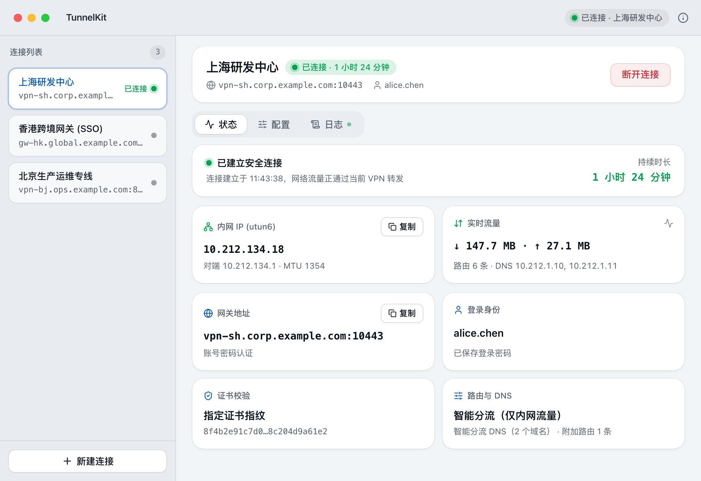
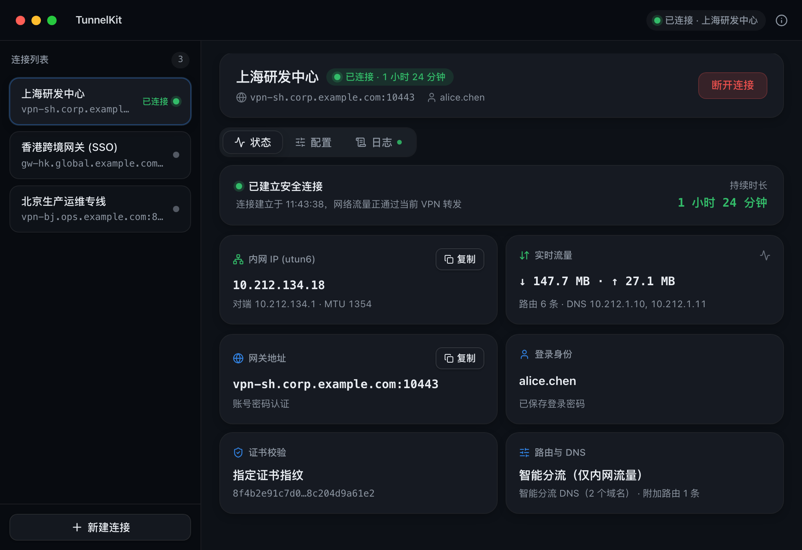
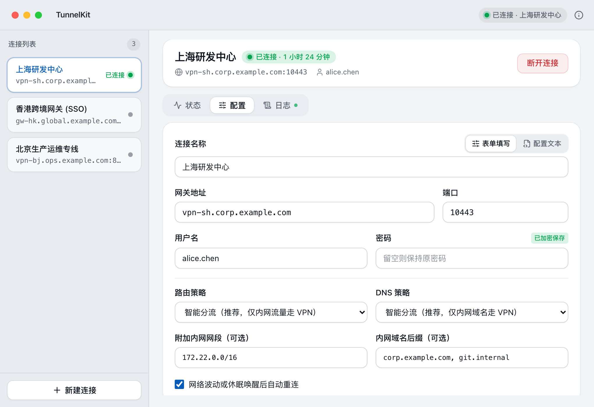
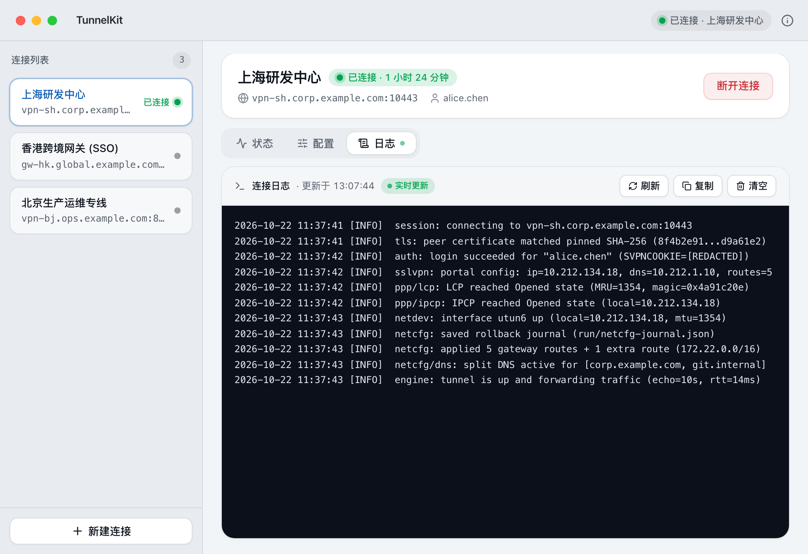

# TunnelKit

<div align="center">
  
</div>

> 🛡️ **TunnelKit** 是基于 **Wails v3**、**Go** 与 **Vue 3 + TypeScript** 构建的轻量级跨平台 Fortinet（FortiGate）SSL-VPN 桌面与菜单栏客户端，支持 macOS、Windows 和 Linux。

<div align="center">


</div>

<details>
  <summary>点击查看桌面端界面截图</summary>
  
  
  
  
</details>

---

## 📦 下载

macOS DMG（`Universal` / `arm64` / `amd64`）、Windows 便携版 ZIP（`amd64` / `arm64`）、Linux `amd64` 压缩包与 `SHA256SUMS.txt` 校验文件可从 [GitHub Releases](https://github.com/maybk/tunnelkit/releases) 下载。

macOS App 如果提示无法验证开发者，可执行：

```bash
xattr -dr com.apple.quarantine "/Applications/TunnelKit.app"
```

## ✨ 功能特性

### 🎯 核心功能

- **多种认证方式** - 支持账号密码登录、OTP 动态口令、FortiToken 推送确认与 SAML 浏览器单点登录
- **多连接配置管理** - 支持「表单填写」与「配置文本」实时双向同步，方便快速导入或批量修改
- **一键切换连接** - 在已连接状态下选中其他配置，可直接一键断开当前隧道并切换到目标连接
- **路由与 DNS 分流** - 支持按网关规则或全局转发流量、自定义补充网段，以及按内网域名后缀分流 DNS
- **连接诊断与证书信任** - 自动识别常见连接故障，遇到自签名或内网网关证书时可一键信任并重连

### 🎨 用户体验

- **桌面与菜单栏常驻** - 支持关闭窗口隐藏到 macOS 菜单栏或 Windows / Linux 系统托盘，随时快速操作
- **浅色与深色主题** - 支持浅色与深色外观切换
- **实时日志与搜索** - 支持按日志级别与关键词实时筛选，一键复制诊断信息

### 🔧 技术特性

- **原生 Go 协议引擎** - 内置自包含的 `fortivpn` 协议内核，无需安装 `FortiClient` 或依赖 `openfortivpn` 等外部命令行工具，开箱即用
- **按会话最小权限隔离** - 桌面界面以普通用户权限运行，仅在建立隧道时按需拉起后台辅助服务，断开即退出
- **密码加密与日志脱敏** - 密码在本机加密存储，运行日志自动遮蔽密码、令牌与会话凭据
- **网络状态自动恢复** - 异常断开或进程意外退出后自动清理并恢复宿主路由与 DNS 设置

## 🖥️ 支持平台

- **macOS** - 最低支持 macOS 12.0（Monterey），提供 `Universal`、`arm64`（Apple Silicon）与 `amd64`（Intel）安装包
- **Windows** - 支持 Windows 10 / 11，提供 `amd64`（x64）与 `arm64` 便携包
- **Linux** - 支持基于 `GTK4` + `WebKitGTK 6.0` 的主流发行版（`amd64`）

## 🚀 快速开始

本地开发需要 Go 1.27+、Node.js 24+、pnpm 以及 [Wails v3 CLI](https://v3.wails.io/quick-start/installation/)：

```bash
pnpm --dir frontend install
wails3 dev
```

## 🏗️ 技术架构

### 核心技术栈

- **Wails v3** - 跨平台桌面与菜单栏应用框架
- **Go 1.27+** - 桌面端状态机、后台隧道服务与 `fortivpn` 协议内核
- **Vue 3.5 + TypeScript 6.0 + Tailwind CSS v4** - 桌面工作台界面
- **WireGuard `tun` / Wintun** - 跨平台虚拟网卡适配

```text
Vue 前端 -> Wails bindings -> internal/api -> internal/vpn -> internal/helperclient -> tunnelkit-helper -> fortivpn
```

## 📚 项目文档

- [项目概览与目录结构](./docs/guide/overview.md)
- [配置说明](./docs/guide/configuration.md)
- [开发与构建](./docs/guide/development.md)
- [发布指南](./docs/guide/release.md)
- [更新日志](./CHANGELOG.md)

## ⚠️ 免责声明

1. **合规使用** - 请仅在已获得访问授权的网络网关上使用本客户端。
2. **数据隐私** - 所有配置、密钥与运行日志均保存在本机 `~/.tunnelkit/` 目录，不会向任何外部服务器上传数据。
3. **使用风险** - 使用本应用产生的网络路由变更或任何直接、间接损失，开发者不承担责任。

---

<div align="center">
  <p>如果这个项目对您有帮助，请给个 ⭐️ 支持一下！</p>
</div>

[](https://www.star-history.com/#maybk/tunnelkit&Date)
